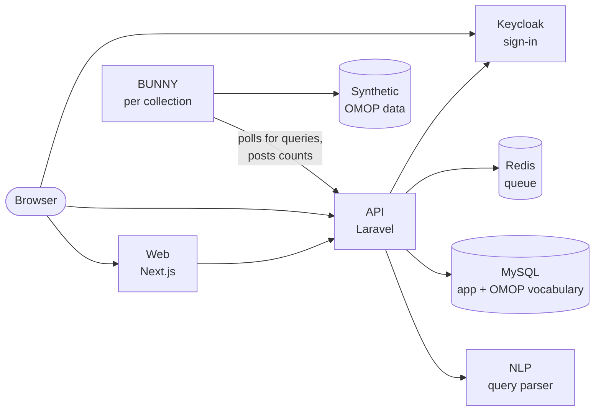

# cohort-discovery-service-stack

Run the Cohort Discovery Service on your own Kubernetes cluster.

The Cohort Discovery Service lets researchers ask "how many people match these criteria?" across many data collections at once, without seeing any individual's record. Each collection stays with its data custodian; a small agent beside the data, BUNNY, picks up queries, runs them and sends back rounded counts.

This repo runs the whole service in **standalone mode**: the web app, the API, the NLP query parser, single sign-on through Keycloak, an OMOP vocabulary and synthetic collections that return results straight away. One Helm chart defines it; Tilt drives it on a laptop.



## Quick start

You need:

- a local Kubernetes cluster (Rancher Desktop, Docker Desktop, OrbStack, minikube, kind or k3d) with about 4 CPUs and 8 GB of memory;
- `kubectl`, `helm` 3, `tilt` and `openssl`;
- **for now, a GitHub token that can read HDR UK's private `hdruk/*` composer packages.** The API image can't be built without them. Making the API buildable by anyone is on the [tracker](docs/README.md).

```bash
git clone --recurse-submodules https://github.com/HDRUK/cohort-discovery-service-stack.git
cd cohort-discovery-service-stack
export GITHUB_TOKEN=$(gh auth token)
tilt up
```

The first build takes ten minutes or so. When everything in the Tilt UI (http://localhost:10350) is green, open http://localhost:3000, choose **Single Sign-On**, and sign in as one of the fictional users. Their passwords are generated for your install:

| User | Can | Password |
|---|---|---|
| `admin@example.com` | administer the service | `kubectl -n cohort-discovery get secret cohort-discovery-secrets -o jsonpath='{.data.admin-password}' \| base64 -d` |
| `researcher@example.com` | query the two synthetic collections | `... -o jsonpath='{.data.keycloak-user-researcher-password}' \| base64 -d` |
| `custodian@example.com` | manage the "Demo Custodian" collections | `... -o jsonpath='{.data.keycloak-user-custodian-password}' \| base64 -d` |

[Getting started](docs/getting-started.md) walks through it in full, including a first query.

## Documentation

| | |
|---|---|
| [Overview](docs/overview.md) | What each part does, how a query flows, and the words the service uses |
| [Getting started](docs/getting-started.md) | Run it on your laptop with Tilt |
| [Running with Helm](docs/running/helm.md) | Run it without Tilt |
| [Installing beyond a laptop](docs/installing/beyond-a-laptop.md) | Ingress, TLS, external databases and identity providers, secrets |
| [Customising](docs/customising/index.md) | Users and access, branding, collections, vocabulary and NLP rules |
| [Troubleshooting](docs/operations/troubleshooting.md) and [Maintaining](docs/operations/maintaining.md) | When something goes wrong, logs, upgrades, resets |
| [Chart values](docs/reference/values.md) | Every setting in the chart |

To read the docs as a site locally: `pip install -r requirements-docs.txt && mkdocs serve`, then open http://localhost:8000.

## What's in the repo

| Path | What |
|---|---|
| `customisations/` | Everything you're expected to change, one folder per service. See [Customising](docs/customising/index.md) |
| `charts/cohort-discovery/` | The Helm chart, the one definition of the stack, with example values for shared clusters |
| `services/` | The web, API and NLP source, as git submodules pinned to releases |
| `scripts/` | Generating local secrets, turning `customisations/` into chart values, building the branded web image |
| `Tiltfile` | Local development |
| `generated/` | Git-ignored: your local secrets and the generated customisations values |
| `docs/` | The user docs, plus the project's [plan and ticket tracker](docs/README.md) |

## Status

Usable for local evaluation and development: the services, single sign-on, the full OMOP vocabulary import, provisioning of custodians and collections, synthetic collections and the custom branding all work. Installing on a shared cluster is in review. Published images and CI are still to come. See the [tracker](docs/README.md).

## Personal data

The service stores researchers' email addresses, identity-provider claims and activity logs. Read the [personal data inventory](docs/data-protection/personal-data-inventory.md) before you run it with real users.
