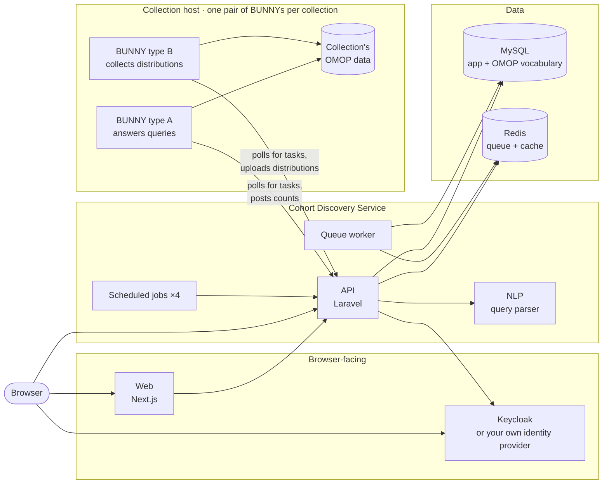

# cohort-discovery-service-stack

**📖 Read the docs: https://hdruk.github.io/cohort-discovery-service-stack/**

Run the Cohort Discovery Service on your own Kubernetes cluster.

The Cohort Discovery Service lets researchers ask "how many people match these criteria?" across many data collections at once, without seeing any individual's record. Each collection stays with its data custodian; agents beside the data, BUNNYs, pick up queries, run them and send back rounded counts.

This repo runs the whole service in **standalone mode**: the web app, the API, the NLP query parser, single sign-on through Keycloak, an OMOP vocabulary and synthetic collections that return results straight away. One Helm chart defines it; Tilt drives it on a laptop.



## Quick start

You need a local Kubernetes cluster (about 4 CPUs and 8 GB of memory), `kubectl`, `helm` 3, `tilt`, `openssl`, and **a GitHub token**, which the API image build needs.

```bash
git clone --recurse-submodules https://github.com/HDRUK/cohort-discovery-service-stack.git
cd cohort-discovery-service-stack
export GITHUB_TOKEN=$(gh auth token)
tilt up
```

When everything in the Tilt UI (http://localhost:10350) is green, open http://localhost:3000 and choose **Single Sign-On**. The users and where their passwords are: [Run locally](https://hdruk.github.io/cohort-discovery-service-stack/getting-started/#sign-in).

## What's in the repo

| Path | What |
|---|---|
| `customisations/` | Everything you're expected to change, one folder per service. See [How to customise](https://hdruk.github.io/cohort-discovery-service-stack/customising/) |
| `charts/cohort-discovery/` | The Helm chart, the one definition of the stack, with example values for shared clusters |
| `services/` | The web, API and NLP source, as git submodules pinned to releases |
| `scripts/` | Generating local secrets, turning `customisations/` into chart values, building the branded web image |
| `Tiltfile` | Local development |
| `docs/` | The source of the docs site, plus the project's [plan and ticket tracker](docs/README.md). Contributing: [CONTRIBUTING.md](CONTRIBUTING.md) |

For the service itself (BUNNY, identity providers, OMOP requirements), see the general [Cohort Discovery Service docs](https://hdruk.github.io/cohort-discovery-service-docs/).

## Status

Usable for local evaluation and development, and installable on a shared cluster, with the [known limitations](https://hdruk.github.io/cohort-discovery-service-stack/deploying/#known-limitations). See the [tracker](docs/README.md).

## Personal data

The service stores researchers' email addresses, identity-provider claims and activity logs. Read the [personal data inventory](https://hdruk.github.io/cohort-discovery-service-stack/data-protection/personal-data-inventory/) before you run it with real users.
