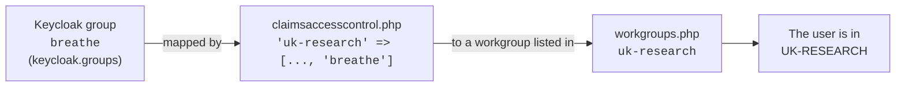

# Identity and access

Keycloak decides who can do what. The service docs explain [how sign-in works and what an identity provider must support](https://hdruk.github.io/cohort-discovery-service-docs/developers/deploying/identity-provider/), with a [Keycloak worked example](https://hdruk.github.io/cohort-discovery-service-docs/developers/deploying/examples/keycloak/); this page covers the stack's own Keycloak and files. On every sign-in, the API replaces the user's workgroups, roles and custodians with what Keycloak's ID token says. To change someone's access, change it in Keycloak and have them sign in again.

Three things have to line up for a Keycloak group to mean anything in the app:



## The default users

| User | Keycloak groups | Realm role | In the app |
|---|---|---|---|
| `admin@example.com` (Demo Admin) | `Demo Custodian`, `default` | `platform-admin` | The seeded admin: roles `admin` and `user`, member of custodian "Demo Custodian" |
| `researcher@example.com` (Jane Doe) | `breathe`, `default` | `researcher` | Workgroup `UK-RESEARCH`, role `user` |
| `custodian@example.com` (John Smith) | `Demo Custodian`, `default` | `data-custodian` | Roles `custodian` and `user`, member of custodian "Demo Custodian" |

The admin is in the `Demo Custodian` group because custodian membership comes from Keycloak too: without the group, their first sign-in would remove them from the custodian the setup gave them.

The admin is the only user created in the app in advance (by `api-init`, from `bootstrap.adminEmail`). The others are created on their first sign-in.

## Add a user

Users are defined in the chart values, under `keycloak.users`, so that every install gets them. In a values file of your own (with Helm), or in `charts/cohort-discovery/values.yaml` (under Tilt):

```yaml
keycloak:
  users:
    # keep the default users you still want, then add:
    - email: alex.taylor@example.com
      firstName: Alex
      lastName: Taylor
      groups: [ukri]
      realmRoles: [researcher]
      passwordKey: alexTaylorPassword
```

1. Every group and role a user names must be in `keycloak.groups` and `keycloak.roles`, or the install fails and names the user. `username` defaults to `email`.
2. Add the `passwordKey` to `generated/secrets.values.yaml` under `secrets:`, with a password of your choosing: `alexTaylorPassword: "…"`. A missing key fails the install with a message naming it. In the cluster it becomes the Secret key `keycloak-user-alex-taylor-password`.
3. [Re-import the realm](#re-import-the-realm).

Every user is also put in `keycloak.defaultGroup` (`default`). It keeps a `groups` claim in the token even for a user with no other group, because the API treats a missing claim as "no information" and leaves that user's workgroups as they were. Set it to `""` to turn this off.

To try something quickly on a running stack, you can also add a user in the Keycloak admin console (http://localhost:8180/admin, user `admin`, password from `keycloak-admin-password`). Console changes are lost on the next re-import, and users created there are put in `default` automatically.

## Add a group that grants a workgroup

For example, to give everyone in a Keycloak group `example-uni` the `UK-RESEARCH` workgroup:

1. Add `example-uni` to `keycloak.groups` and to the users who should have it.
2. Map it in `customisations/api/claimsaccesscontrol.php`:

    ```php
    'workgroup_mappings' => [
        'uk-research' => ['ukri', 'ncs', 'breathe', 'example-uni'],
    ```

3. If the workgroup is new, add it to `customisations/api/workgroups.php` (see [Workgroups](#workgroups)).
4. [Re-import the realm](#re-import-the-realm), then sign in again.

## Map Keycloak names to the app

`customisations/api/claimsaccesscontrol.php` replaces the API's own `config/claimsaccesscontrol.php`. The stack's Keycloak names differ from the app's on purpose, to show the mapping. The service docs explain [claim mapping](https://hdruk.github.io/cohort-discovery-service-docs/developers/deploying/claim-mapping/) and the [access-control policy](https://hdruk.github.io/cohort-discovery-service-docs/developers/deploying/access-control-policy/) (trust, authoritative sync, floors) in full; this section covers how the stack sets them.

| Setting | What |
|---|---|
| `workgroup_mappings` | App workgroup ⇒ Keycloak group, or a list of groups. `'uk-research' => ['ukri', 'ncs', 'breathe']` gives `UK-RESEARCH` to anyone in any of the three. A group can appear under several workgroups: `gsk` gives `UK-INDUSTRY` and `NON-UK-INDUSTRY`. Groups that aren't mapped, including `default`, give no workgroup |
| `role_mappings` | App role (`admin`, `user`, `custodian`) ⇒ Keycloak realm role. The stack uses `platform-admin`, `researcher` and `data-custodian` |
| `sync` | How each sign-in applies them. The stack sets workgroups, roles and custodians to `trust: always` and `authoritative: true`: every sign-in replaces what the user had. The file's comments list the other options |

A group also links the user to a custodian **with the same name** (ignoring case), if one exists. That's how `Demo Custodian` works. Signing in never creates a custodian; create it with `bootstrap.custodianName` or in `provision.json`.

The service docs suggest setting the policy with `CLAIM_SYNC_*` environment variables. The stack mounts the whole file instead, with every value written in, so the mappings and the policy live in one file you can review and diff. While it's mounted, the `CLAIM_SYNC_*` variables have no effect. When the API is upgraded, compare the file with the new upstream one.

A workgroup can take a list of groups, as above, even though the service docs describe one group per workgroup: the API accepts either.

To check what the API is using:

```bash
kubectl -n cohort-discovery exec deploy/cohort-discovery-api -c api -- \
  php artisan tinker --execute="dump(config('claimsaccesscontrol.workgroup_mappings'))"
```

## Workgroups

`customisations/api/workgroups.php` lists the workgroups the app has. The stack seeds `UK-RESEARCH`, `UK-INDUSTRY`, `NON-UK-RESEARCH`, `NON-UK-INDUSTRY` and `NHS-SDE`, and leaves out the API's `ADMIN`, `CUSTODIAN`, `DEFAULT` and `OTHER` (the file says why).

To add one, add it to the list. `api-init` creates any that are missing every time it runs, matching names case-insensitively. It never deletes or renames one, so removing a name from the list doesn't remove the workgroup. Signing in never creates a workgroup either: a mapping to a workgroup that doesn't exist does nothing.

## Password sign-in

`password_login` in `customisations/api/auth.php` turns email and password sign-in on or off. It's off, so the login page offers only single sign-on, and the API refuses `POST /api/auth/login`. Set `'enabled' => true` to turn it back on; the admin's password is `admin-password`.

With Keycloak turned off and no other identity provider, there's no single sign-on, so the API offers password sign-in whatever this file says.

## The realm

`customisations/keycloak/realm.json` holds the realm's client and settings. Keep the realm name `cohort-discovery-service` and the client ID `cohort-discovery-service-api`. The chart always replaces the file's `groups`, `roles`, `users` and `defaultGroups` with the `keycloak.*` values, so set those in the values, not in the file. The client secret, passwords and URLs come from `${CDS_*}` placeholders, filled in from Keycloak's environment at import.

The browser and the API must reach Keycloak at the same URL. Locally that's `http://localhost:8180`: Keycloak listens on that port inside the cluster too, and the API pod forwards its own `localhost:8180` to it.

### Re-import the realm

Keycloak imports the realm only when its volume is new. Changes to `realm.json`, the users, groups and roles, the ports or the passwords don't reach an existing realm. To re-import it:

```bash
tilt down
kubectl -n cohort-discovery delete pvc cohort-discovery-keycloak-data
tilt up
```

With Helm, stop Keycloak, delete its volume, and upgrade, which creates a new volume and starts Keycloak again:

```bash
kubectl -n cohort-discovery scale deployment/cohort-discovery-keycloak --replicas=0
kubectl -n cohort-discovery delete pvc cohort-discovery-keycloak-data
helm upgrade cohort-discovery charts/cohort-discovery -n cohort-discovery -f … --timeout 15m
```

Users keep the same Keycloak IDs across re-imports, because the chart derives each ID from the realm name and the username, so the app's links to them still match. Changing a user's username gives it a new ID.

## Change the admin

The admin is named in three places, which must agree:

1. `bootstrap.adminEmail`: the user `api-init` creates in the app, and the user the provision Job signs in as.
2. A `keycloak.users` entry with the same email, so they can sign in. The provision Job signs in with this user's Keycloak password, the Secret key `keycloak-user-<passwordKey>`. The default, `passwordKey: adminPassword`, makes it the same password `api-init` gives the admin in the app.
3. That user's `groups` should include `bootstrap.custodianName`, so their first sign-in doesn't remove them from the custodian.

`api-init` creates the admin only when the app has no users at all, so on an existing install, make someone an admin in Keycloak (realm role `platform-admin`) instead.
