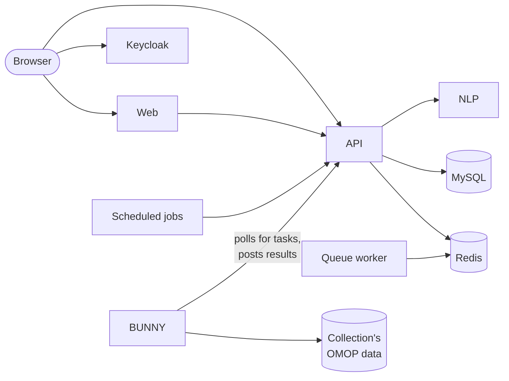

# Overview

The Cohort Discovery Service answers one question for researchers: *how many people, across these data collections, match my criteria?* A researcher builds a query in the web app, the query goes to every collection they're allowed to see, and each collection answers with a rounded count. Nobody sees a record about an individual.

This repo runs the service in **standalone mode**: it signs people in through its own identity provider (a bundled Keycloak by default) rather than through the HDR UK Gateway.

## The parts

| Part | What it does | Runs as |
|---|---|---|
| **Web** | The Next.js app researchers, custodians and admins use | Deployment `cohort-discovery-web` |
| **API** | The Laravel API: users, custodians, collections, queries and the tasks BUNNYs pick up | Deployment `cohort-discovery-api` |
| **Queue worker** | Runs the API's background jobs (Horizon) | Deployment `cohort-discovery-queue` |
| **NLP** | Turns a free-text question ("women over 50 with type 2 diabetes") into a structured query, matching terms against the OMOP vocabulary | Deployment `cohort-discovery-nlp` |
| **MySQL** | Two databases: the app's own data, and the OMOP vocabulary (concepts and how they relate) | StatefulSet `cohort-discovery-mysql` |
| **Redis** | The queue and cache | StatefulSet `cohort-discovery-redis` |
| **Keycloak** | Signs people in, and says which groups and roles they have | Deployment `cohort-discovery-keycloak` |
| **Scheduled jobs** | Four CronJobs that call the API every minute to collect distributions, clean up tasks and watch for inactive collections | CronJobs `cohort-discovery-<job>` |
| **BUNNY** | Sits beside a collection's data, polls the API for tasks, runs them and posts back counts. In this stack, one per synthetic collection | Deployments `cohort-discovery-bunny-<collection>` |
| **Synthetic data** | A Postgres with a database of made-up OMOP data for each synthetic collection | StatefulSet `cohort-discovery-synthetic-db` |

Three Jobs set things up, and are safe to run again:

| Job | What |
|---|---|
| `api-init` | Migrates the database, seeds the workgroups, roles and the minimal vocabulary, and creates the first admin and custodian. See [Internals](reference/internals.md) |
| `provision` | Creates the custodians, collection hosts and collections in `customisations/provision.json` through the API. See [Collections](customising/collections.md) |
| `vocab-import` | Only if you supply an Athena download: imports the full OMOP vocabulary. See [Vocabulary](customising/vocabulary.md) |

## How a query flows

1. A researcher signs in through Keycloak. On every sign-in the API sets their workgroups and roles from the groups and roles Keycloak sends.
2. They build a query in the web app, either with the query builder or by typing it, in which case the NLP turns it into one.
3. The API creates a task for each collection the researcher's workgroups can see.
4. Each collection's BUNNY polls the API, picks up its task, runs it against its OMOP data and posts back a count, rounded and with small numbers suppressed.
5. The web app shows the counts as they arrive.

Separately, BUNNYs collect **distributions** on a schedule: counts per concept and demographic breakdowns, which fill the term directory and the "Last Distribution" columns.

## Start-up order

`mysql`, `redis` and `keycloak` start first, then `api-init`, then `api`, `queue` and `nlp`, then `web`, the scheduled jobs and `provision`, and finally the BUNNYs, which need the credentials `provision` creates. The chart holds back the API, queue, NLP, web and provision pods with init containers until what they need is ready, so `helm install` without Tilt behaves the same. The scheduled jobs simply retry, and the BUNNYs fail and restart until their host's Secret exists.

## Words the service uses

| Word | Meaning |
|---|---|
| **Collection** | One dataset that can be queried, for example one hospital's records |
| **Custodian** | The organisation responsible for one or more collections. Custodian users manage its collections |
| **Collection host** | The technical endpoint a custodian runs, a BUNNY, that answers for one or more collections. It has its own API credentials |
| **BUNNY** | The open-source agent from the University of Nottingham ([Hutch](https://github.com/Health-Informatics-UoN/hutch)) that runs queries beside the data |
| **Workgroup** | A group of researchers, such as `UK-RESEARCH`. A collection is shared with workgroups; a researcher sees the collections shared with any of theirs |
| **Role** | What a user can do in the app: `admin`, `custodian` or `user` |
| **OMOP CDM** | The Observational Medical Outcomes Partnership Common Data Model, the shared shape every collection's data is in |
| **OMOP vocabulary** | The standard concepts (conditions, drugs, measurements…) queries are built from. Downloaded from [Athena](https://athena.ohdsi.org) |
| **Distribution** | Per-concept and demographic counts a BUNNY collects on a schedule, rather than in answer to a query |
| **Standalone mode** | The service runs on its own, with its own identity provider, rather than inside the HDR UK Gateway |
| **Synthetic collection** | A collection served from made-up data, so the service returns results with no real data. It describes no real people |
