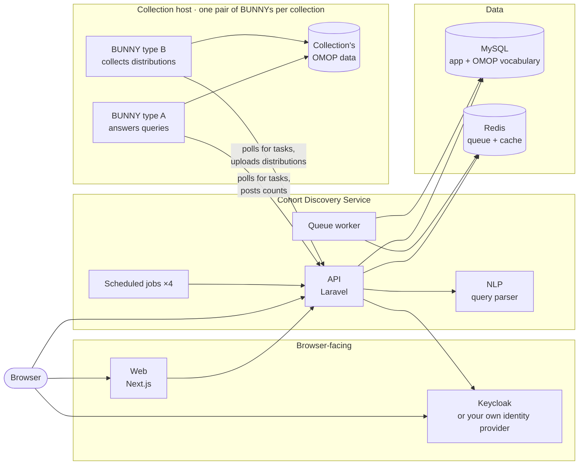

# Overview

The Cohort Discovery Service answers one question for researchers: *how many people, across these data collections, match my criteria?* A researcher builds a query in the web app, the query goes to every collection they're allowed to see, and each collection answers with a rounded count. Nobody sees a record about an individual. The service docs explain the [platform and the federated model](https://hdruk.github.io/cohort-discovery-service-docs/architecture/platform/) in more depth.

This stack runs the service in **standalone mode**: people sign in through its own identity provider (a bundled Keycloak by default) rather than through the HDR UK Gateway.

## The parts

Every arrow from a collection host points towards the API: BUNNYs call out to fetch tasks, and the service never connects to a custodian's data. In this stack the collection hosts are synthetic and run inside the cluster; a real custodian runs them next to their own data (see [Connect a collection](deploying/connect-a-collection.md)).

| Part | What it does | Runs as |
|---|---|---|
| **Web** | The Next.js app researchers, custodians and admins use | Deployment `cohort-discovery-web` |
| **API** | The Laravel API: users, custodians, collections, queries and the tasks BUNNYs pick up | Deployment `cohort-discovery-api` |
| **NLP** | Turns a typed question ("women over 50 with type 2 diabetes") into a structured query, matching terms against the OMOP vocabulary | Deployment `cohort-discovery-nlp` |
| **Queue worker** | Runs the API's background jobs (Horizon), such as processing uploaded distributions | Deployment `cohort-discovery-queue` |
| **Scheduled jobs** | Four CronJobs that call the API every minute to create due distribution tasks, clean up tasks and watch collections. See [Scheduled jobs](reference/scheduled-jobs.md) | CronJobs `cohort-discovery-<job>` |
| **Keycloak** | Signs people in, and says which groups and roles they have. Replaceable by your own identity provider | Deployment `cohort-discovery-keycloak` |
| **MySQL** | Two databases: the app's own data, and the OMOP vocabulary | StatefulSet `cohort-discovery-mysql`, or your own |
| **Redis** | The queue and cache | StatefulSet `cohort-discovery-redis`, or your own |
| **BUNNY type A and type B** | Run next to a collection's data. Type A answers queries; type B collects distributions. Each collection needs one of each | For synthetic collections, one Deployment per collection with two containers: `cohort-discovery-bunny-<collection>` |
| **Synthetic data** | A Postgres with a database of made-up OMOP data for each synthetic collection | StatefulSet `cohort-discovery-synthetic-db` |

Three setup Jobs prepare the database and collections; see [Internals](reference/internals.md).

## How a query flows

1. A researcher signs in through the identity provider. On every sign-in, the API sets their workgroups and roles from the groups and roles the provider sends.
2. They build a query in the web app, with the query builder or by typing it, in which case the NLP turns it into one.
3. The API creates a task for each collection the researcher's workgroups can see.
4. Each collection's type A BUNNY polls the API, picks up its task, runs it against its OMOP data and posts back a count: rounded, with small numbers reported as 0.
5. The web app shows the counts as they arrive.

Separately, the `distributions-collector` scheduled job creates **distribution** tasks when a collection's schedule is due (for collections the provision Job creates: concept counts weekly and demographics monthly). The type B BUNNY picks them up and uploads the results, which fill the term directory and the "Last Distribution" columns.

## Words the service uses

The service docs' [glossary](https://hdruk.github.io/cohort-discovery-service-docs/reference/glossary/) defines BUNNY, data custodian, OMOP and the data-environment terms. These are the others you'll meet in this stack:

| Word | Meaning |
|---|---|
| **Collection** | One dataset that can be queried, for example one hospital's records |
| **Custodian** | The organisation responsible for one or more collections. Custodian users manage its hosts and collections |
| **Collection host** | One set of BUNNY credentials (a client ID and secret). It isn't a machine and holds no data; one host can serve the BUNNYs of several collections |
| **BUNNY type A** | The BUNNY that answers researchers' queries (`TASK_API_TYPE=a`) |
| **BUNNY type B** | The BUNNY that collects distributions (`TASK_API_TYPE=b`) |
| **Distribution** | Per-concept and demographic counts a type B BUNNY collects on a schedule, rather than in answer to a query |
| **Workgroup** | A group of researchers, such as `UK-RESEARCH`. A collection is shared with workgroups; a researcher sees the collections shared with any of theirs |
| **Role** | What a user can do in the app: `admin`, `custodian` or `user` |
| **OMOP vocabulary** | The standard concepts (conditions, drugs, measurements…) queries are built from |
| **Standalone mode** | The service runs on its own, with its own identity provider, rather than inside the HDR UK Gateway |
| **Synthetic collection** | A collection served from made-up data, so the service returns results without real data. It describes no real people |
