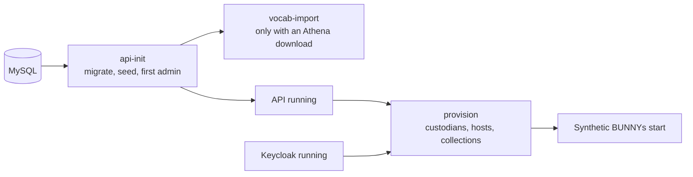

# Internals

What the setup Jobs do, for when you need to know why something is the way it is. Every Job is safe to run again.

## `api-init`

Runs `charts/cohort-discovery/files/api-init/api-init.sh` in the API image, as a Helm post-install and post-upgrade hook.

| Step | When it runs again |
|---|---|
| Database migrations, the `omop` migrations, `deploy:run` | Only pending ones run |
| `WorkgroupSeeder` | Every time. Creates the workgroups in `customisations/api/workgroups.php` that are missing, and never deletes one |
| `RolesAndPermissionsSeeder` | Only when `roles` is empty |
| `StateSeeder`, `FeatureSeeder`, `PersonalAccessClientSeeder` | Every time. They create only what's missing |
| `MinimalOmopSeeder` | Only when `omop.concept` is empty, so it never touches a full import |
| `ensure-admin.php`: the custodian `bootstrap.custodianName`, and the admin `bootstrap.adminEmail` with role `admin`, as a member of it | Only when `users` is empty, so an install with users is never rewritten. It finds each record before creating it, so a run that failed part-way can be repeated |
| The scheduler's service account, from the `scheduler-client-id` and `scheduler-client-secret` secrets | Every time. Left alone when it matches, updated when it doesn't |

The Passport signing keys come from the Secret, so sign-ins survive pod restarts.

## `provision`

Runs `charts/cohort-discovery/files/provision/provision.py` in a Python image, as a post-install and post-upgrade hook after `api-init`. It:

1. signs in to the API as `bootstrap.adminEmail`, by filling in the Keycloak login form. With the bundled Keycloak it uses that user's Keycloak password (`keycloak-user-<passwordKey>`); with an external Keycloak, the `admin-password` secret;
2. checks every workgroup named in `provision.json` exists, and stops before changing anything if one doesn't;
3. creates each custodian, host and collection that's missing, matched by name;
4. writes each new host's credentials to the Secret `bunny-<host>`, and the collection IDs to the same Secret;
5. shares each collection with its workgroups, makes it active, and adds its distribution schedules;
6. restarts a host's BUNNYs when it created that host or one of its collections.

See [Collections](../customising/collections.md).

## `vocab-import`

Runs only when `vocab.athena.hostPath` or `vocab.athena.existingClaim` is set, as a post-install and post-upgrade hook after `api-init`. It mounts the folder or volume read-only, compares the release in `VOCABULARY.csv` with the one imported, and if they differ replaces each table from the CSV files, `VOCABULARY` last. See [Vocabulary](../customising/vocabulary.md).

## How pods reach `localhost` URLs

The browser, the API and the provision Job must all use the same URLs for the API and Keycloak, because sign-in redirects and tokens are tied to them. Locally those are `localhost` URLs, which inside a pod would mean the pod itself. So the API and web pods run small `socat` containers that listen on the URL's port and forward to the right Service, and `*.localhost` names are mapped to `127.0.0.1`. The provision Job reroutes those hosts itself (`ROUTE_HOSTS`). On a shared cluster with real hostnames, the pods need DNS for them or `hostAliases`.
